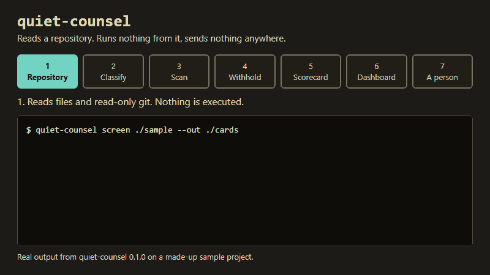

<div align="center">

# Quiet Counsel

**Hand it an agent project's repository. It runs nothing from it, sends nothing anywhere, and gives you flags with the file and line behind each one.**

[](CHANGELOG.md)
[](LICENSE)
[](pyproject.toml)
[](https://github.com/sourav-patra/quiet-counsel/actions/workflows/gate.yml)
[](docs/LIMITS.md)

[Page](https://sourav-patra.github.io/quiet-counsel/) · [Install](docs/INSTALL.md) · [Docs](#docs) · [Notices](docs/NOTICES.md)



*Real output on one made-up sample project: each flag cites a file and line. It shows the output format, not accuracy on real projects.*

</div>

## Why

Quiet Counsel is for people who review agent projects they did not write, such as hackathon judges with a hundred submissions.

An agent project is text and small scripts:

- hooks: commands an editor or agent runs on its own
- skills: instruction files for an agent
- workflow files: automation steps

Such a repository can run a command when you open the folder, or hold a key someone pasted by accident.

Reading a hundred submissions by hand does not scale. Running them to find out is the risk.

Quiet Counsel reads the files and tells you which projects to read first, and which lines in them. Scripts flag and a person rules.

The output is an order of attention. A project with no flags is not declared safe. A project with flags is not declared bad.

Evidence: on 2 November 2026 the author screened 50 public agent repositories ([field run](docs/field-run-2026-11-02.json), [limits](docs/LIMITS.md)).

- It raised 4 critical, 31 serious, 36 warning and 34 information flags.
- No person has read them all, so this shows volume and says nothing about accuracy.


*How it works: everything the tool does stays on one machine, and a person makes the final ruling at step 7. The diagram shows scope, not accuracy or speed.*

## Features

- Runs on the Python standard library: no network call, no model, no dependency.
- Every flag names its evidence: a file and line with the quoted text, or a command or commit.
- A line that holds a credential shape is quoted as `<line withheld>`.
- Checks hooks that run on open, install scripts, workflows, hidden characters, text that addresses an automated judge, licences (including share-alike licences such as the GPL found inside a permissive project), copied files and stated counts and figures in the README, such as a skill count ([the list](docs/CHECKS.md)).
- Notes when the README quotes a score or ranking and the tree holds no eval result file (`score-without-result`, information); a setup file alone does not count as a result. Both README checks are informational: on 50 fresh repositories they raised 2 flags (covering 3 README lines), 1 true and 1 false, too few for a rate.
- Compares four README statements with the files: licence, "no dependencies", `--flags` of the project's own command and paths it says the repository holds. Others do this too; the check cites both sides, is informational and carries no cap.
- Claims it cannot support, such as SOC 2, are recorded as claims with status `unsupported`. They are not flags.
- Output is a scorecard (one JSON file per project) and one HTML page you can open, email or commit.
- Screens one repository or a hundred, with copy detection against a corpus you supply.
- A band (blocked, review, shortlist, screened) is the order in which to read projects, with blocked first. It disqualifies nobody and says nothing about safety.

## Quick start

1. Install from the tag, then write a sample project that has planted problems.

```sh
pip install "git+https://github.com/sourav-patra/quiet-counsel@v0.1.1"
quiet-counsel sample ./sample
```

   Check: `quiet-counsel --version` prints `quiet-counsel 0.1.1`, the sample command prints `sample project written to ./sample`, and `ls sample` lists `agents`, `scripts`, `skills`, `tests`, `vendor`, `LICENSE` and `README.md`.

2. Screen it.

```sh
quiet-counsel screen ./sample --out ./cards
```

   Check: the screen prints two lines. The first counts the scorecards written. The second starts with `blocked    sample`, then the project type, then the severity and id of each flag.

```text
1 scorecard(s) written to ./cards
  blocked    sample                             catalogue     critical:secret-in-tree, serious:curl-pipe-shell, serious:hidden-characters, critical:evaluator-directed-text, critical:copyleft-in-permissive-tree, serious:contradicted-claim
```

3. Build the dashboard, then open `cohort.html`.

```sh
quiet-counsel dashboard ./cards/*.json --out cohort.html
```

   Check: the command prints `cohort.html: 1 project(s), ` and the file size, the file `cohort.html` exists, and `grep "Quiet Counsel review" cohort.html` finds its title.

4. Read the evidence behind a flag in `cards/sample.json`.

   Check: it holds a flag with id `copyleft-in-permissive-tree` and severity `critical`.
   - Its first evidence item has `ref` `vendor/fastclip/LICENSE:1` and `excerpt` `[GPL] GNU GENERAL PUBLIC LICENSE`.
   - The flag `secret-in-tree` at `scripts/deploy.sh:2` has the excerpt `[aws-access-key] <line withheld>`, so you open that line yourself.

[examples/sample-dashboard.html](examples/sample-dashboard.html) is the page built from the sample.

pipx, uv, source, Windows, upgrade and uninstall are in [docs/INSTALL.md](docs/INSTALL.md).

A GitHub Actions snippet is in [docs/CI.md](docs/CI.md), and every command is in [docs/cli.md](docs/cli.md).

## Limits

- Accuracy on real repositories is not measured. A benchmark on author-built fixtures exists ([docs/BENCHMARK.md](docs/BENCHMARK.md)); it does not say how often these problems occur in real repositories.
- It reads files in one directory tree. It cannot see stolen accounts, package registries, extension marketplaces, runtime behaviour or deployed versions.
- It never runs an agent, so it cannot say whether an agent performs well.
- Copy detection misses a rewritten copy.
- The README checks (`readme-claim-mismatch` and `score-without-result`) are informational and their accuracy is not measured: too few statements were ruled to state a rate, and what they miss is not measured. Network use and retry counts are not checked.
- A card can hold a credential in a format the tool does not list, so read it before you share it ([SECURITY.md](SECURITY.md)).

The full statement and the field run are in [docs/LIMITS.md](docs/LIMITS.md).

Eight 2026 incident patterns, five of them marked `invisible` to this tool, are in [docs/NOTICES.md](docs/NOTICES.md).

[docs/COMPARISON.md](docs/COMPARISON.md) lists what neighbouring tools need in order to run and what they cover, with no accuracy comparison.

On 2 November 2026 the author ran the drift report from Google's [Elephant-Goldfish Model](https://github.com/google/elephant-goldfish-model) once, on a small made-up project with six planted README contradictions.

The drift report, which uses a model, found all six; this tool found none. One sample measures no accuracy; details are in [docs/COMPARISON.md](docs/COMPARISON.md).

## Use it from an agent

- Three skills in `skills/`: `screen-cohort`, `triage-flags` and `review-project`.
- Three roles in `agents/`: screener, reviewer and verifier. None can write to the project it reads.
- [AGENTS.md](AGENTS.md) holds the instructions every host reads.
- [docs/INSTALL.md](docs/INSTALL.md#skills-and-agent-roles) has the install command.

## Docs

- [docs/INSTALL.md](docs/INSTALL.md), [docs/CI.md](docs/CI.md), [docs/FAQ.md](docs/FAQ.md), [docs/CHECKS.md](docs/CHECKS.md), [docs/LIMITS.md](docs/LIMITS.md)
- [docs/RUBRIC.md](docs/RUBRIC.md), [docs/ARCHETYPES.md](docs/ARCHETYPES.md), [docs/SCREEN-MODE.md](docs/SCREEN-MODE.md), [docs/INTEGRITY.md](docs/INTEGRITY.md)
- [docs/test-suite.md](docs/test-suite.md): every case with its ID, following the method at [why-bureau](https://github.com/sourav-patra/why-bureau). `python3 tools/gate.py` runs it.
- [ARCHITECTURE.md](ARCHITECTURE.md), [RELEASING.md](RELEASING.md), [docs/NOTICES.md](docs/NOTICES.md) (one person maintains the notices and they carry no authority over anyone; corrections go to `https://github.com/sourav-patra/quiet-counsel/issues`)

## Contributing and licence

[CONTRIBUTING.md](CONTRIBUTING.md) describes the workflow. Run `python3 tools/gate.py` before you open a pull request. MIT, see [LICENSE](LICENSE).
